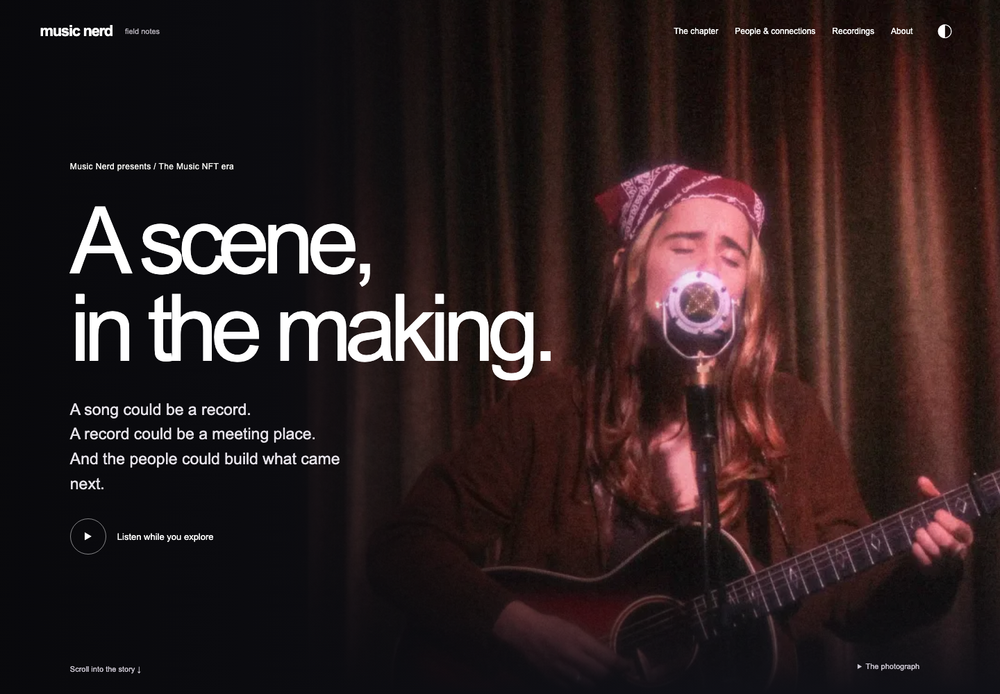

[Source and hosting status](docs/SOURCE-HOSTING.md) · [Music Nerd Lab](https://lab.musicnerd.net)

# The Web3 Music Era

## Originator and creative direction

Concept, editorial direction and creative development by **[Pete Rango](https://github.com/p3t3rango)**, built with AI assistance. Music Nerd is the publishing context; repository ownership does not replace the creator credit.


A standalone Music Nerd listening exhibition about one connected chapter of the Web3 music era. Begin with earlier blockchain-music experiments and Catalog, enter the online rooms where artists met, then follow releases, collaborations, gatherings and what people carried forward. The homepage is a continuous photographic documentary with changing archival frames; deeper evidence and collections remain optional.

The cinematic documentary is the homepage at **`/`**, with **The Collection** holding 241 selected works, including 18 videos. This is a partial community account, not a definitive history. The earlier presentation is retained at `/legacy/` for regression testing. `/sequence/` redirects to the homepage.



The presentation was rebuilt around artist press photography, Songcamp CC0lab visuals and a nine-scene contact sheet. Image credits distinguish portraits from event evidence. Media rights notes apply before public distribution.

## Run locally

Node 22 or newer. No credentials, database or runtime packages required.

```sh
npm ci
npm start
```

Open **http://127.0.0.1:4178**. The server binds to localhost only. Change `PORT` if needed. Deep links use hashes, for example `/#/moment/walls?person=three-oscillators`.

## Try the journey

1. Scroll straight from the opening into the illustrated story. Artist and source details are optional detours. Or enter the chapter and explore **The music / The token / The relationship**. Listen only if you choose.
2. Follow early digital records into the Twitter, Discord and virtual rooms where people met.
3. Continue through Sound editions, CHAOS, Walls and Zoratopia. Open Three Oscillators → Boy Untitled → supporting oral history; close or go back without losing your place.
4. Hear a later remix and consider what remains when platforms close.
5. Use the opening's visual timeline to branch into $TAPE, Camp Genesis, Overstimulated, the 2021 Gansevoort showcase, Soulection and Sound opening to all artists.

## Collection listening

Use **Play the collection** on the opening to listen while exploring. The bottom player persists across routes, with an expandable queue, shuffle, skip, pause and seeking. It plays the 81 selected works, including videos, rather than claiming complete artist discographies.

## What is live?

| Surface | Data |
| --- | --- |
| Historical moments, dates, people, relationships and source notes | Locally authored, public source-backed fixtures in `src/data.js` and `src/narrative.js` |
| Dutchyyy, Sound of Fractures and Three Oscillators directory identities | On-demand, read-only Music Nerd public API check; pinned ID plus independent profile reference |
| Music | 81 selected works across 39 Ethereum NFT contracts; live token metadata and original media on request, paginated collection browsing; separate official Bandcamp embeds |
| Pete’s public collection | Partial Ethereum research only; no wallet connection or raw export in the app/repository |
| Corrections/contributor submissions | Clearly labeled future feature; no account or write API |

The adapter exposes only a confirmed artist ID, name and Music Nerd URL. Failed, slow or ambiguous responses leave the local story available. No private Lore, raw internal payloads, production mutations or ingestion platform.

## Research, design and verification

- [Era research ledger and 88 discovered archive entries](docs/ERA-RESEARCH-LEDGER.md)
- [NFT contracts, edition sources and artist coverage](docs/NFT-COVERAGE.md)
- [Coverage gaps and deeper research plan](docs/EXPANSION.md)
- [Reference matrix and historical research](docs/RESEARCH.md)
- [Design brief and composition](docs/DESIGN.md)
- [Visual sources, credits and publication rights](docs/MEDIA.md)
- [Images for all 47 people and contributors](docs/PEOPLE-IMAGES.md)
- [Source inventory](docs/SOURCES.md) and [HTTP link checks](docs/SOURCE-LINK-CHECKS.md)
- [Data contract and implementation boundary](docs/DATA.md)
- [Verification, captures and limitations](docs/VERIFICATION.md)
- [Owning issue #1](https://github.com/xdjs/music-nft-era/issues/1)

```sh
npx playwright install chromium
npm run ci
```

The repeatable browser suite mocks upstream directory failure and media failure intentionally. Separate live checks confirmed all three identities and actual Bandcamp playback/pause/stop. To repeat live checks with the server running: `npm run check:live` (requires network access).

No hosted preview, deployment or merge has been performed. To publish later: review the chapter with contributors, authorize a hosting target, configure the read-only adapter there, rerun same-origin/browser checks, and approve deployment. No data migration is needed.

## Reproduce the build / Music Nerd Lab

The [Lab protocol packet](docs/protocol/README.md) records the prompts, process, evidence resources, design decisions, implementation map and verification required to recreate this experience. It is a local preparation artifact, not a submitted Lab entry. Keep it aligned with material changes to the experience.
